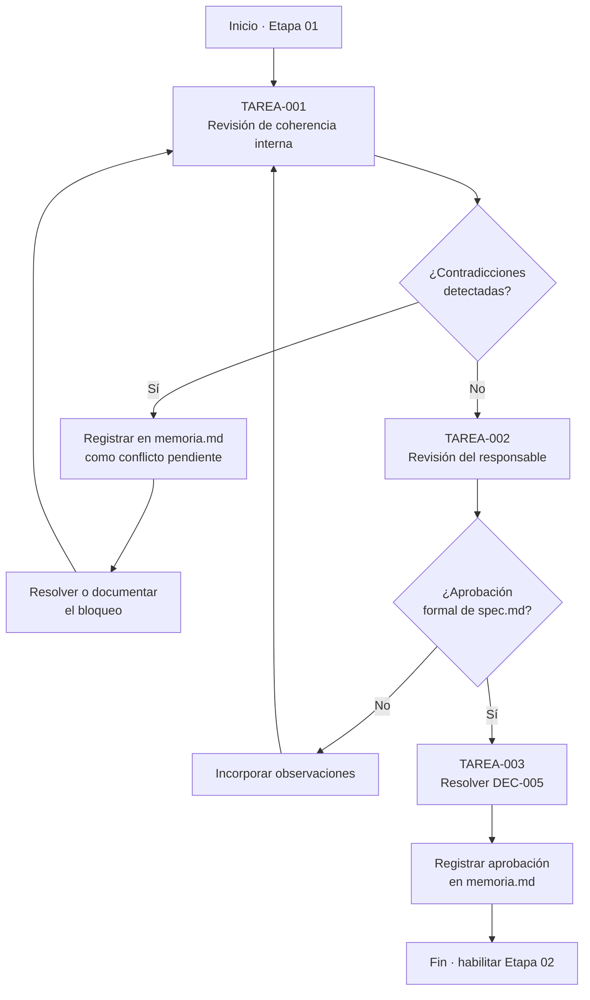
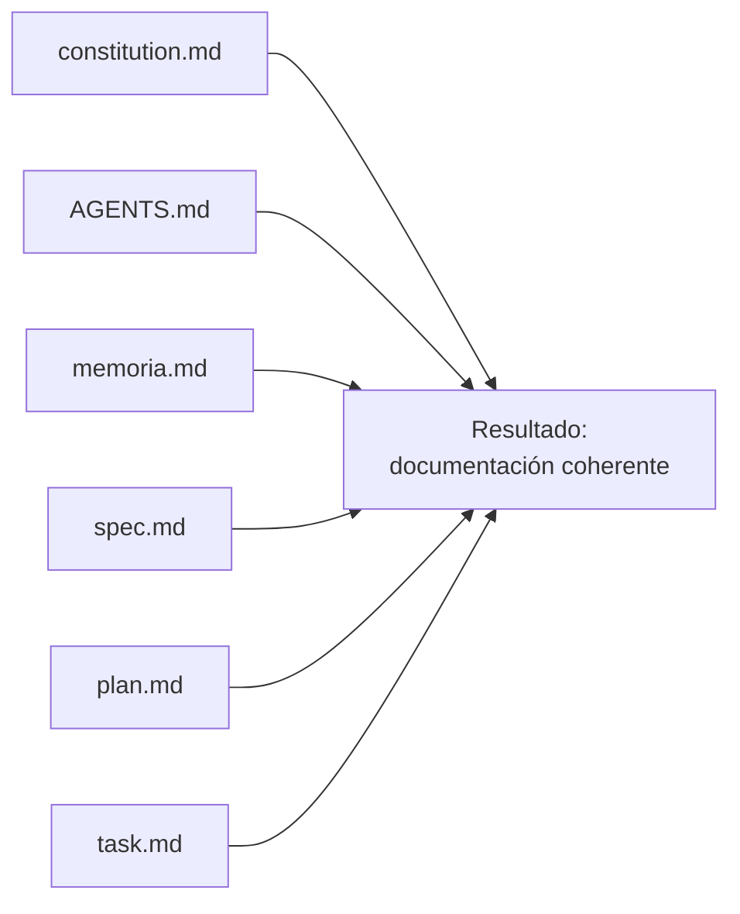
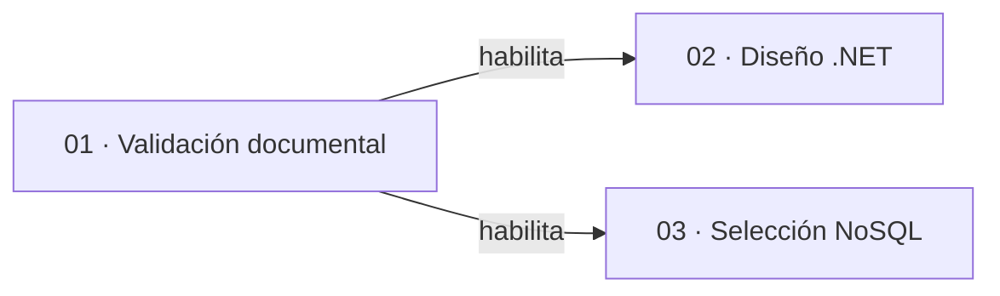
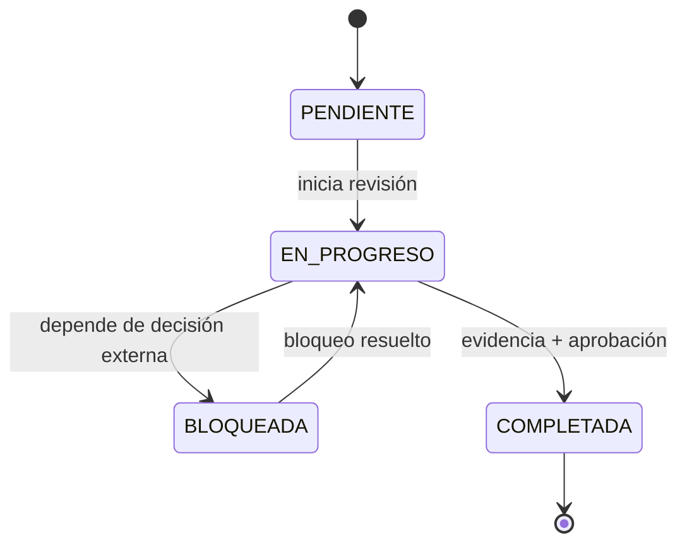

# charts.md — Etapa 01: Validación de la documentación SDD

**Versión:** 1.0.0  
**Estado:** Activo  
**Última actualización:** 2026-10-29  
**Etapa:** 01  
**Referencia:** [`plan.md`](./plan.md) | [`task.md`](./task.md)

> Diagramas de la etapa. Son ilustrativos y no sustituyen los criterios de aceptación de `spec.md`.

---

## 1. Flujo de la etapa

## 2. Documentos revisados

## 3. Dependencias con otras etapas

## 4. Estados de las tareas

## 5. Mapa de criterios de salida

| Criterio de salida | Tarea asociada | Evidencia |
|--------------------|----------------|-----------|
| Coherencia documental | TAREA-001 | Registro de revisión |
| Aprobación de `spec.md` | TAREA-002 | Aprobación en `memoria.md` |
| DEC-005 resuelta | TAREA-003 | Decisión confirmada en `memoria.md` |
