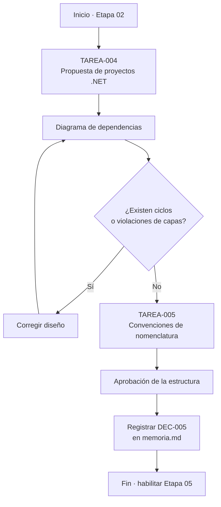
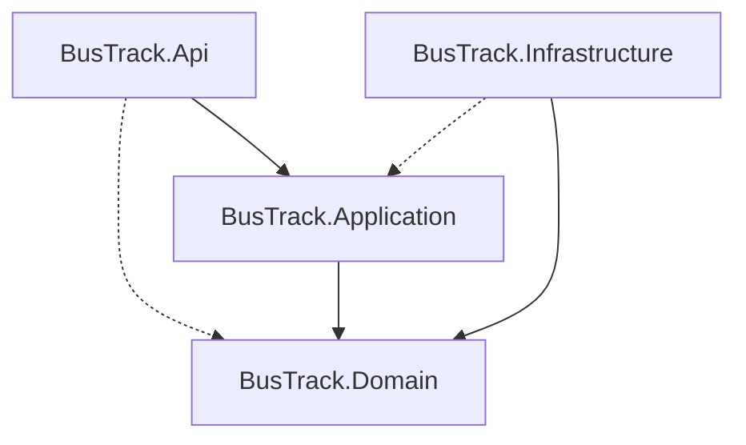
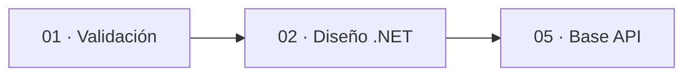
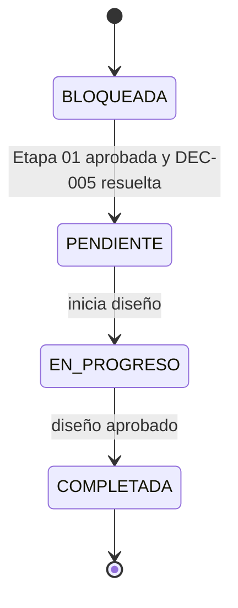

# charts.md — Etapa 02: Diseño de la estructura de la solución .NET

**Versión:** 1.0.0  
**Estado:** Activo  
**Última actualización:** 2026-10-29  
**Etapa:** 02  
**Referencia:** [`plan.md`](./plan.md) | [`task.md`](./task.md)

> Diagramas de diseño propuestos. La estructura definitiva depende de DEC-005 y de la aprobación de esta etapa.

---

## 1. Flujo de la etapa

## 2. Dependencias entre proyectos (propuesta)

> La dependencia `Infrastructure → Application` solo es válida a través de interfaces declaradas en `Domain`. Cualquier dependencia directa está prohibida por `spec.md` sección 6.

## 3. Dependencias con otras etapas

## 4. Estados de las tareas

## 5. Mapa de criterios de salida

| Criterio de salida | Tarea asociada | Evidencia |
|--------------------|----------------|-----------|
| Estructura de proyectos definida | TAREA-004 | Documento de diseño |
| Sin ciclos de dependencia | TAREA-004 | Diagrama de dependencias |
| Convenciones documentadas | TAREA-005 | Documento de convenciones |
