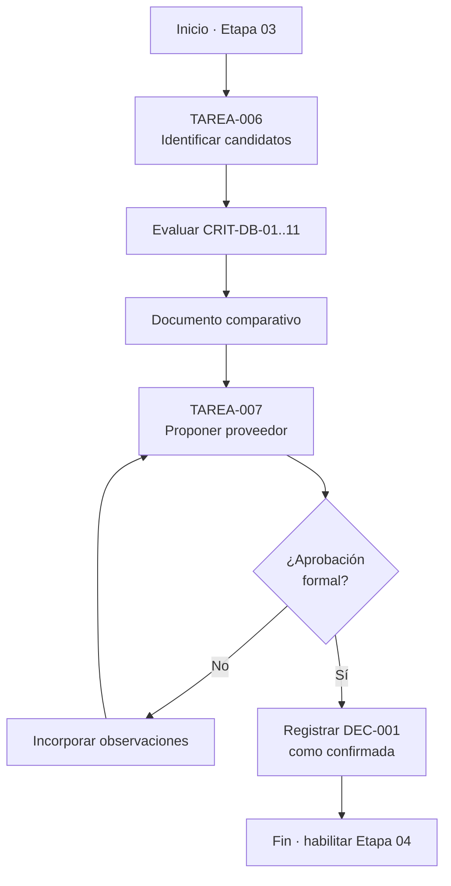
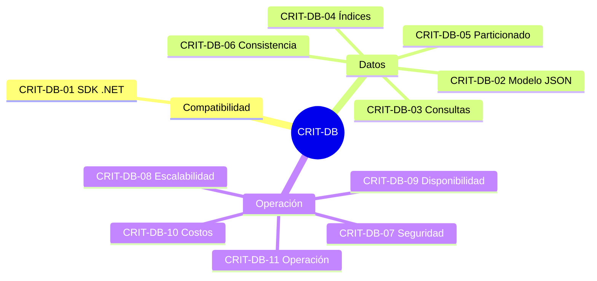
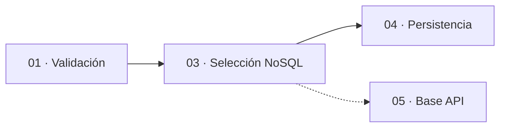
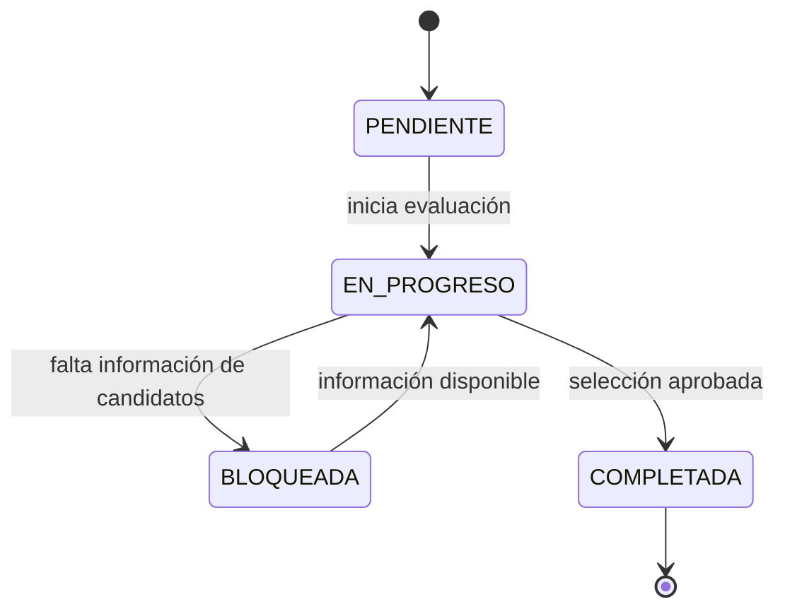

# charts.md — Etapa 03: Selección y aprobación del servicio NoSQL de Azure

**Versión:** 1.0.0  
**Estado:** Activo  
**Última actualización:** 2026-10-29  
**Etapa:** 03  
**Referencia:** [`plan.md`](./plan.md) | [`task.md`](./task.md)

> Diagramas de evaluación. No representan una decisión confirmada sobre el proveedor.

---

## 1. Flujo de evaluación

## 2. Criterios de evaluación

## 3. Dependencias con otras etapas

## 4. Estados de las tareas

## 5. Mapa de criterios de salida

| Criterio de salida | Tarea asociada | Evidencia |
|--------------------|----------------|-----------|
| Evaluación de al menos dos candidatos | TAREA-006 | Documento comparativo |
| Evaluación de los once criterios | TAREA-006 | Matriz de evaluación |
| DEC-001 confirmada | TAREA-007 | Registro en `memoria.md` |
