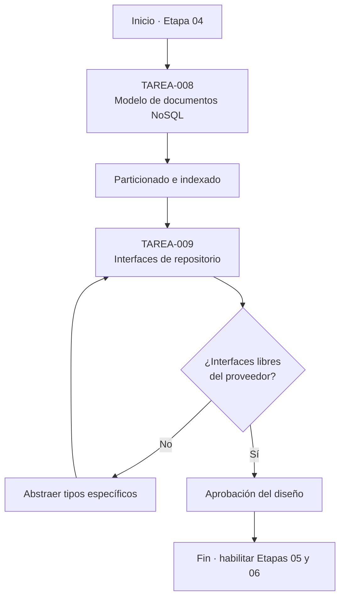
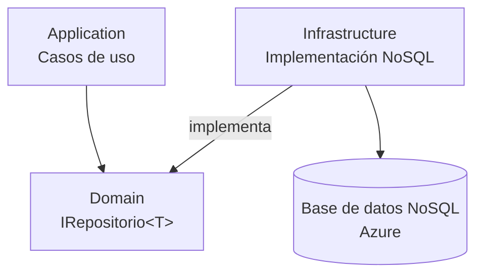
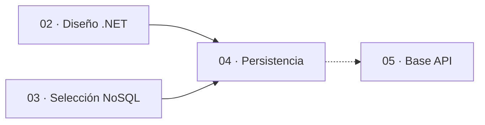
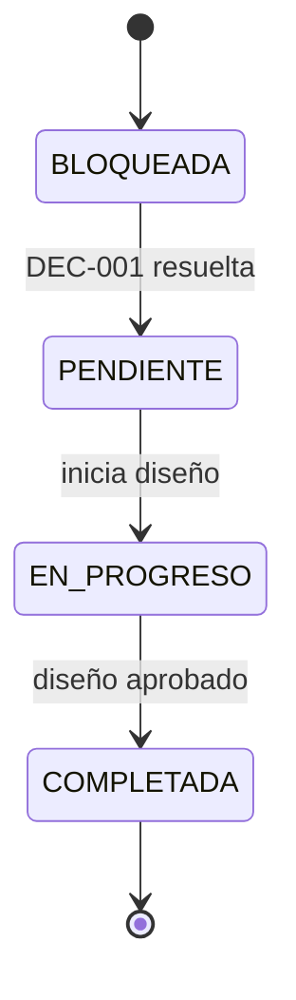

# charts.md — Etapa 04: Diseño de la estrategia de persistencia

**Versión:** 1.0.0  
**Estado:** Activo  
**Última actualización:** 2026-10-29  
**Etapa:** 04  
**Referencia:** [`plan.md`](./plan.md) | [`task.md`](./task.md)

> Diagramas de diseño. Dependen del proveedor NoSQL aprobado en DEC-001.

---

## 1. Flujo de la etapa

## 2. Ubicación de las abstracciones

## 3. Dependencias con otras etapas

## 4. Estados de las tareas

## 5. Mapa de criterios de salida

| Criterio de salida | Tarea asociada | Evidencia |
|--------------------|----------------|-----------|
| Modelo de documentos definido | TAREA-008 | Documento de modelo |
| Particionado e indexado | TAREA-008 | Documento de estrategia |
| Interfaces de repositorio | TAREA-009 | Diagrama y firmas |
