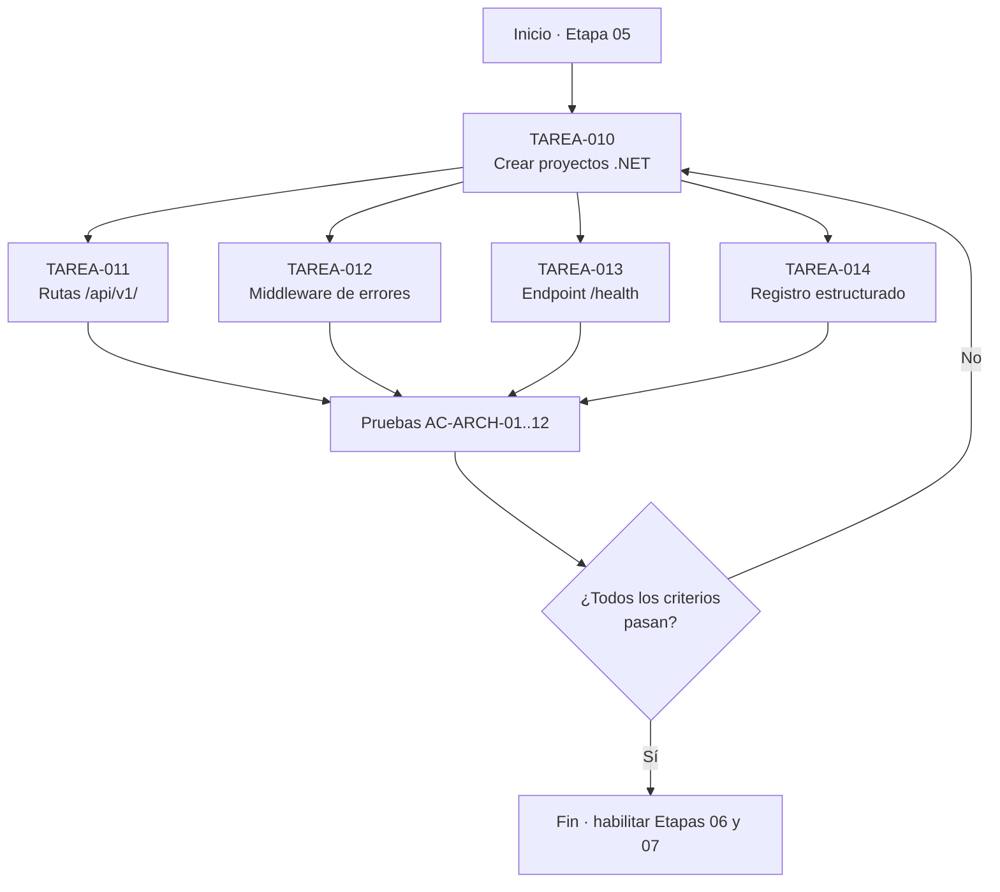
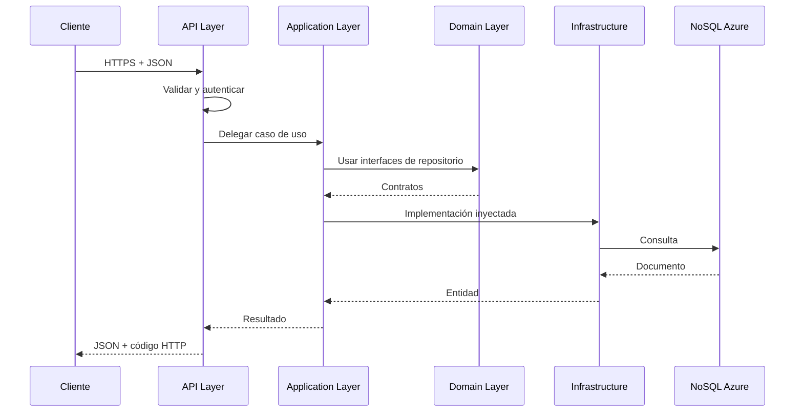
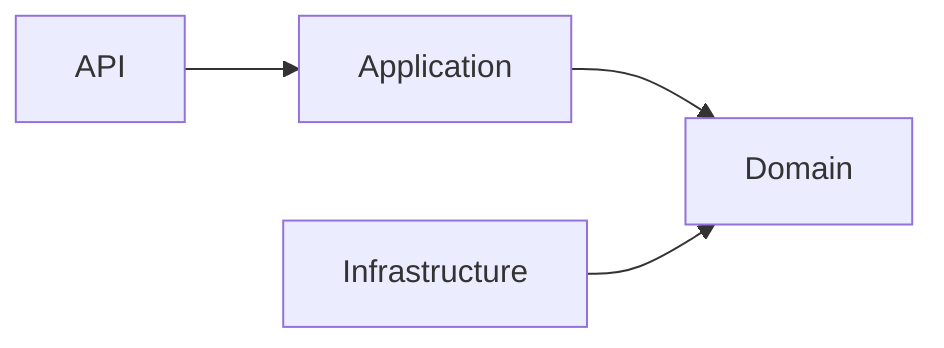
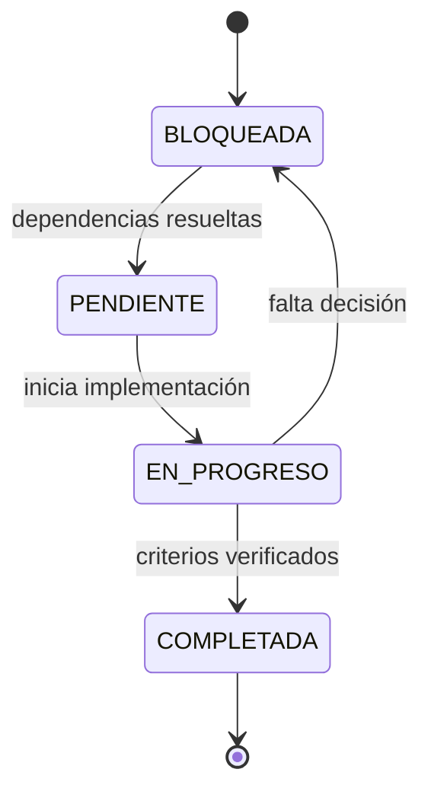

# charts.md — Etapa 05: Preparación de la base de la API

**Versión:** 1.0.0  
**Estado:** Activo  
**Última actualización:** 2026-10-29  
**Etapa:** 05  
**Referencia:** [`plan.md`](./plan.md) | [`task.md`](./task.md)

> Diagramas de la arquitectura base. La estructura de capas está pendiente de aprobación (DEC-005).

---

## 1. Flujo de la etapa

## 2. Flujo de una solicitud

## 3. Capas y dependencias

## 4. Cobertura de criterios de aceptación

| Criterio | Tarea |
|----------|-------|
| AC-ARCH-01, AC-ARCH-02 | TAREA-010 |
| AC-ARCH-03 | TAREA-011 |
| AC-ARCH-08 | TAREA-012 |
| AC-ARCH-07 | TAREA-013 |
| AC-ARCH-05, AC-ARCH-06, AC-ARCH-11, AC-ARCH-12 | TAREA-010 a TAREA-014 |
| AC-ARCH-09 | Etapa 04 / TAREA-009 |
| AC-ARCH-10 | Etapa 07 / TAREA-018 |
| AC-ARCH-04 | Pruebas de integración |

## 5. Estados de las tareas

