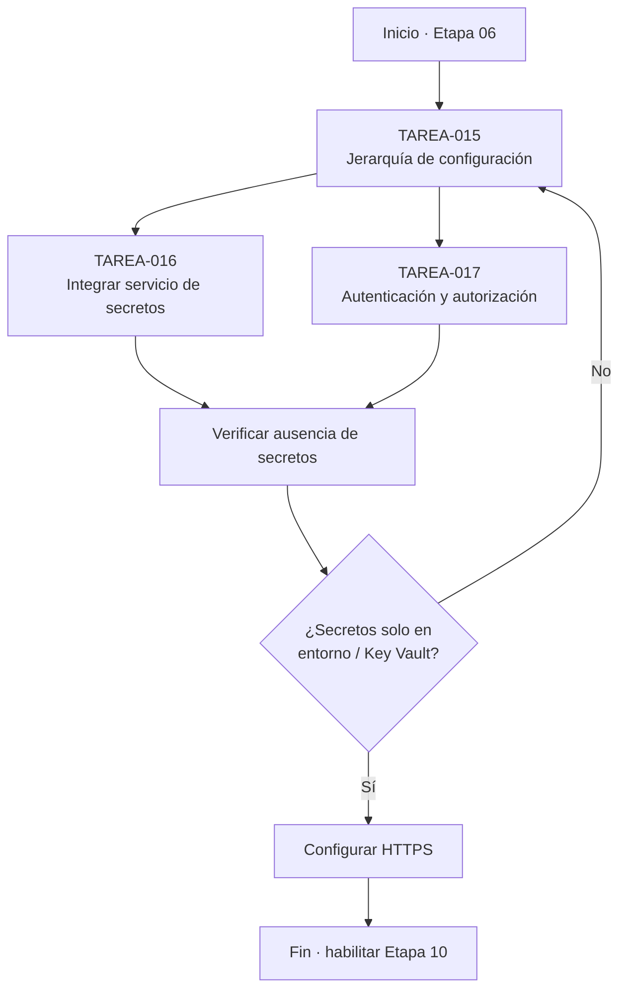
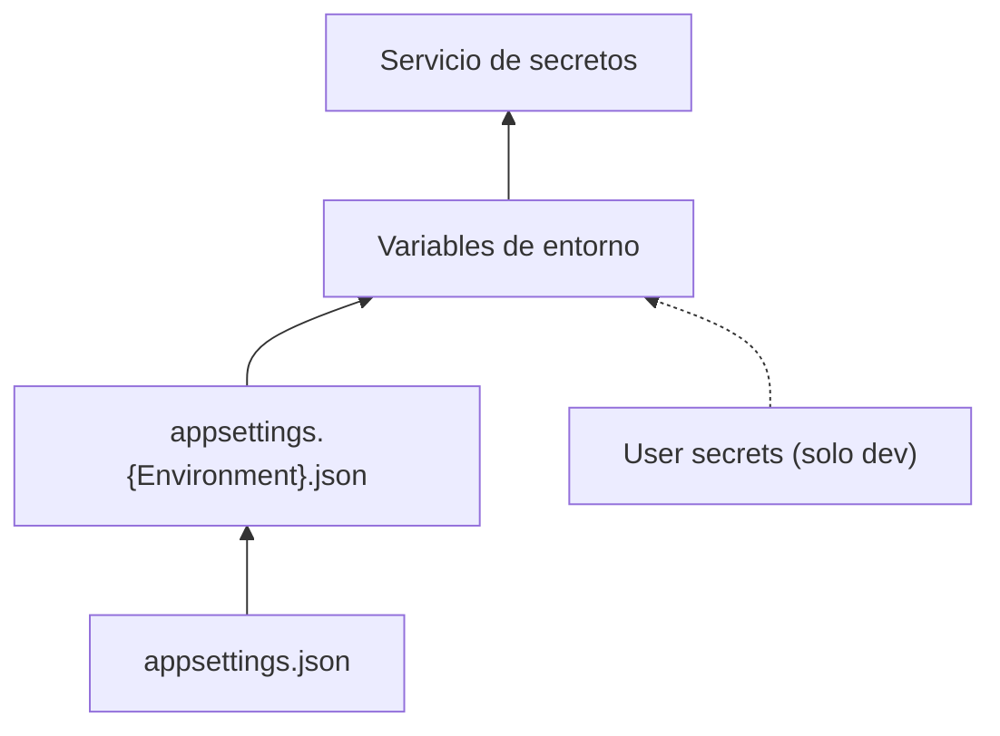
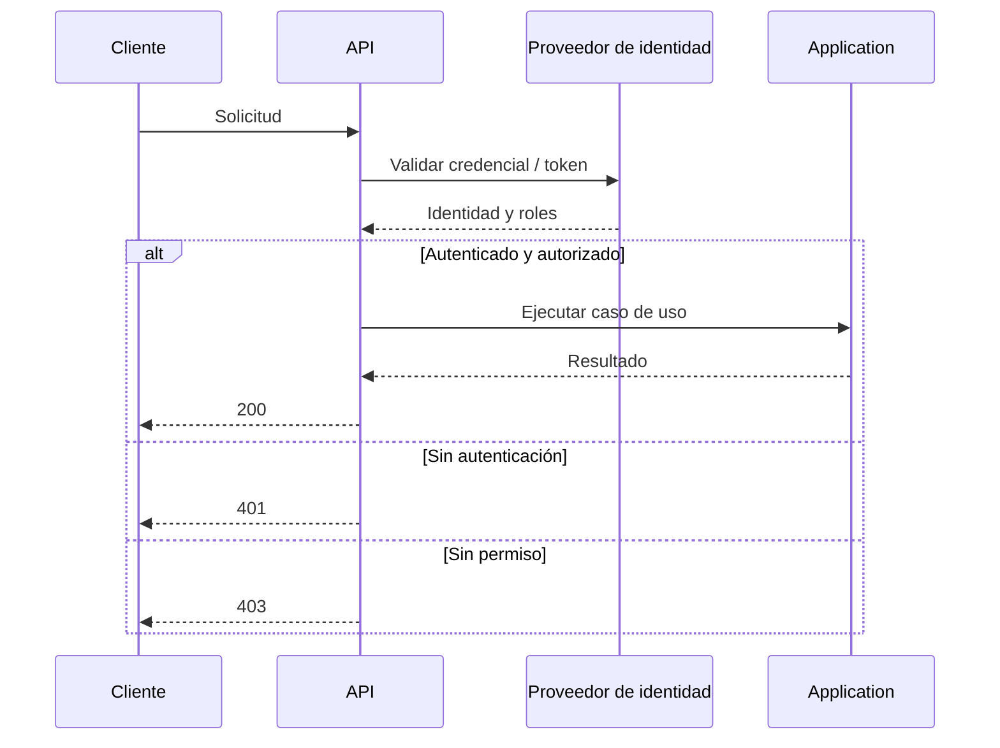
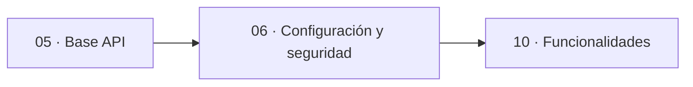
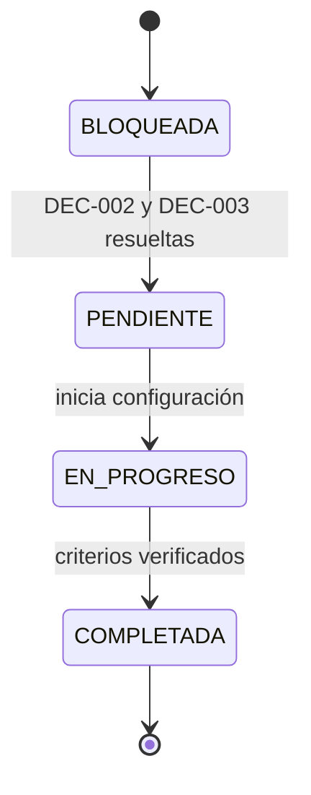

# charts.md — Etapa 06: Configuración y seguridad

**Versión:** 1.0.0  
**Estado:** Activo  
**Última actualización:** 2026-10-29  
**Etapa:** 06  
**Referencia:** [`plan.md`](./plan.md) | [`task.md`](./task.md)

> Diagramas de configuración y seguridad. Las opciones concretas dependen de DEC-002 y DEC-003.

---

## 1. Flujo de la etapa

## 2. Jerarquía de configuración

> De menor a mayor prioridad según `spec.md` sección 9.

## 3. Flujo de autenticación

## 4. Dependencias con otras etapas

## 5. Estados de las tareas

