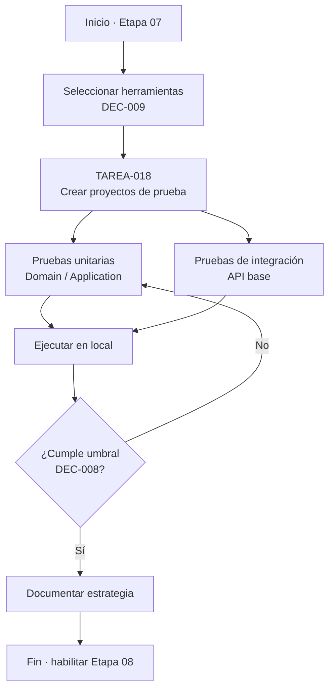
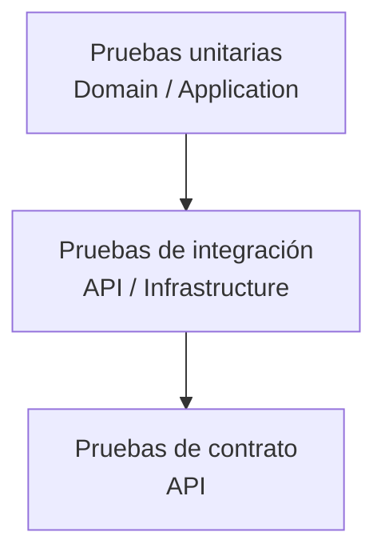
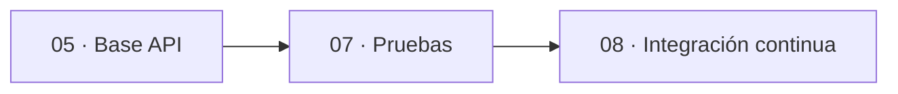
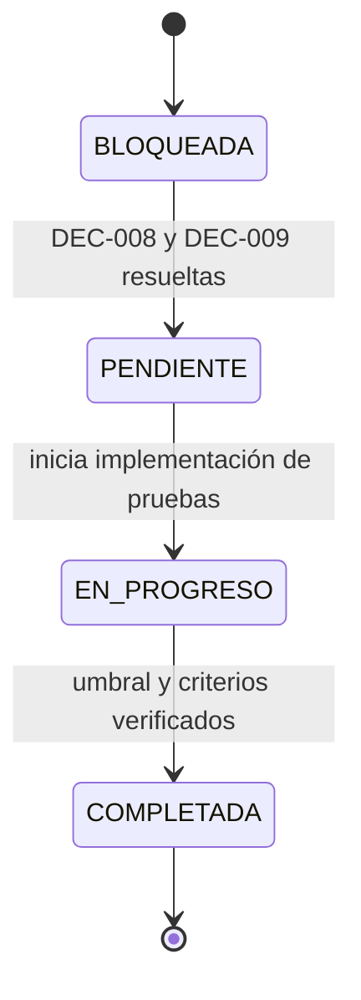

# charts.md — Etapa 07: Estrategia de pruebas

**Versión:** 1.0.0  
**Estado:** Activo  
**Última actualización:** 2026-10-29  
**Etapa:** 07  
**Referencia:** [`plan.md`](./plan.md) | [`task.md`](./task.md)

> Diagramas de la estrategia de pruebas. Las herramientas concretas dependen de DEC-009.

---

## 1. Flujo de la etapa

## 2. Pirámide de pruebas

## 3. Dependencias con otras etapas

## 4. Estados de las tareas

## 5. Mapa de criterios de salida

| Criterio de salida | Evidencia |
|--------------------|-----------|
| Pruebas unitarias sin infraestructura | Resultado de ejecución |
| Pruebas de integración de AC-ARCH | Reporte de pruebas |
| Umbral DEC-008 cumplido | Reporte de cobertura |
