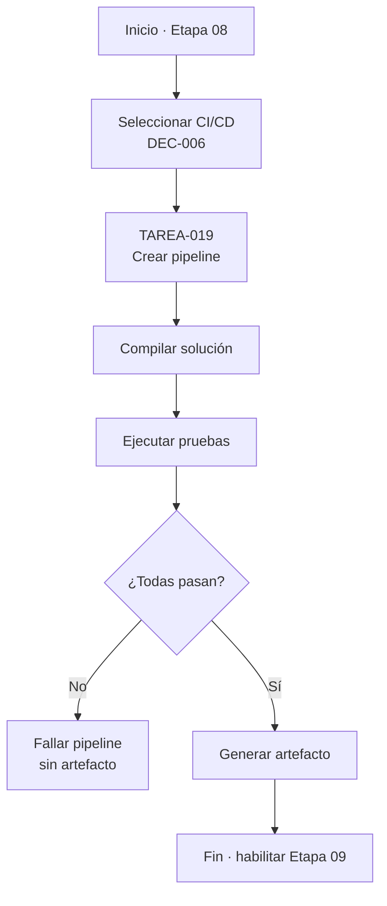
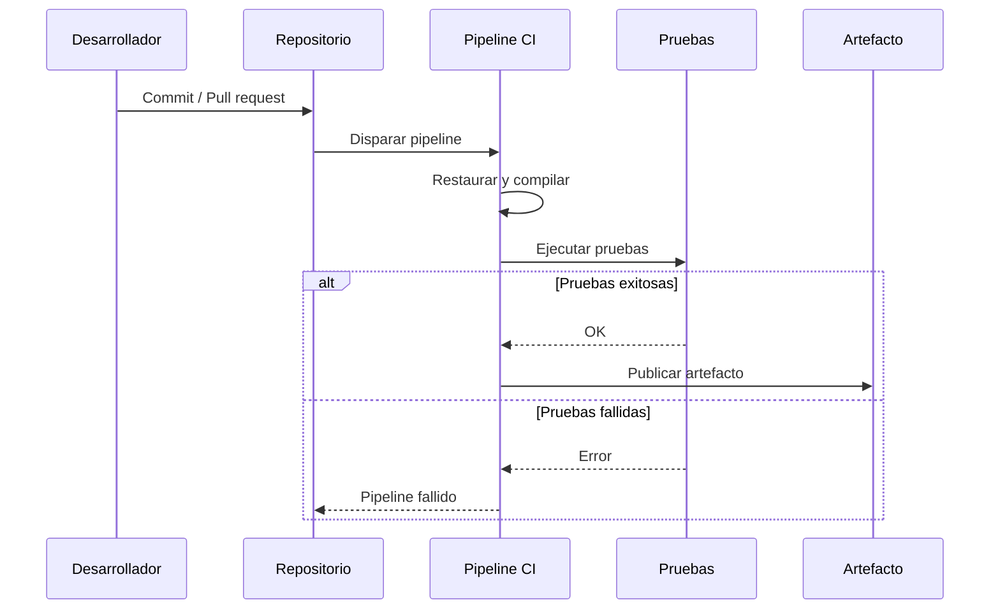
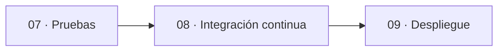
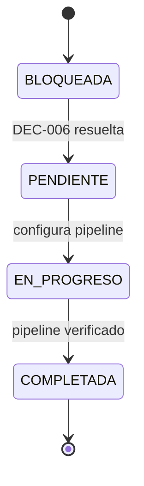

# charts.md — Etapa 08: Integración continua

**Versión:** 1.0.0  
**Estado:** Activo  
**Última actualización:** 2026-10-29  
**Etapa:** 08  
**Referencia:** [`plan.md`](./plan.md) | [`task.md`](./task.md)

> Diagramas del pipeline de integración continua. La herramienta concreta depende de DEC-006.

---

## 1. Flujo de la etapa

## 2. Pipeline propuesto

## 3. Dependencias con otras etapas

## 4. Estados de las tareas

## 5. Mapa de criterios de salida

| Criterio de salida | Evidencia |
|--------------------|-----------|
| Pipeline ejecuta pruebas | Ejecución registrada |
| Falla con pruebas rotas | Ejecución fallida documentada |
| Sin artefacto si fallan pruebas | Configuración del pipeline |
