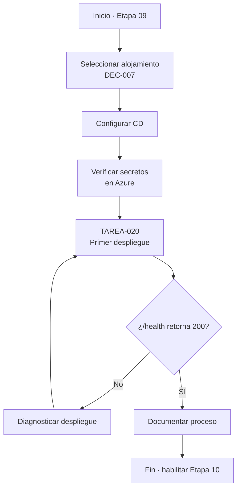
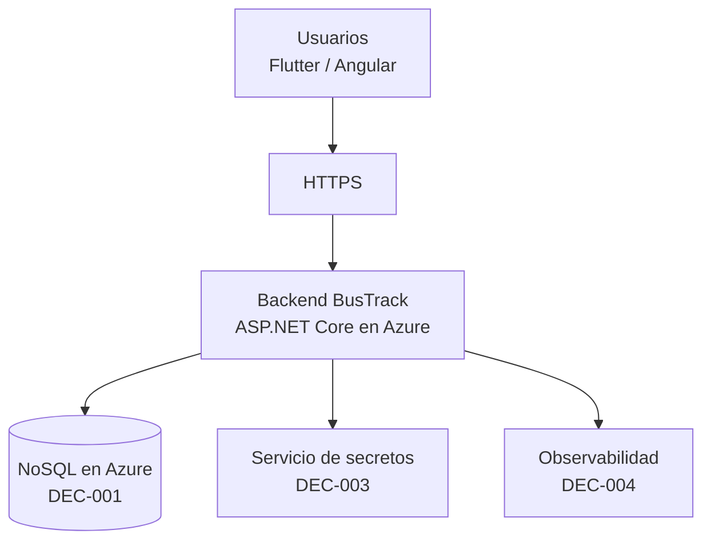
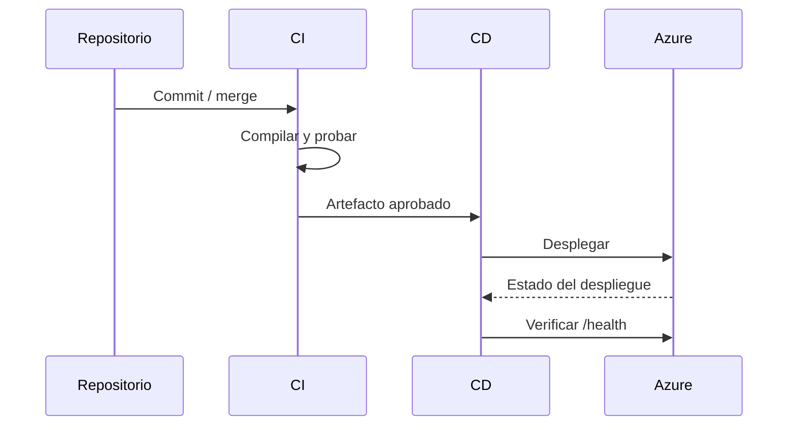
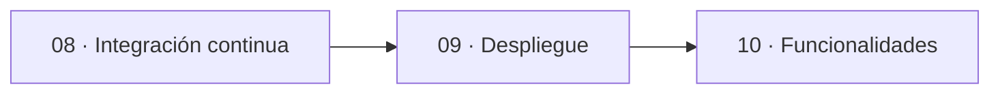
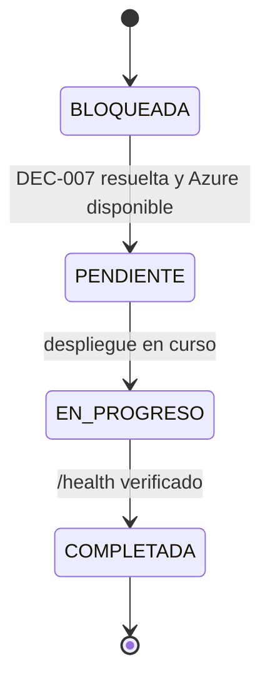

# charts.md — Etapa 09: Preparación del despliegue en Azure

**Versión:** 1.0.0  
**Estado:** Activo  
**Última actualización:** 2026-10-29  
**Etapa:** 09  
**Referencia:** [`plan.md`](./plan.md) | [`task.md`](./task.md)

> Diagramas de despliegue. El servicio de alojamiento concreto depende de DEC-007.

---

## 1. Flujo de la etapa

## 2. Topología de despliegue (propuesta)

## 3. Pipeline de entrega

## 4. Dependencias con otras etapas

## 5. Estados de las tareas

