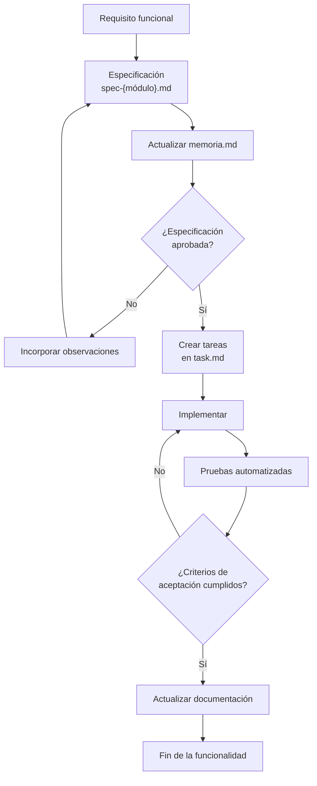
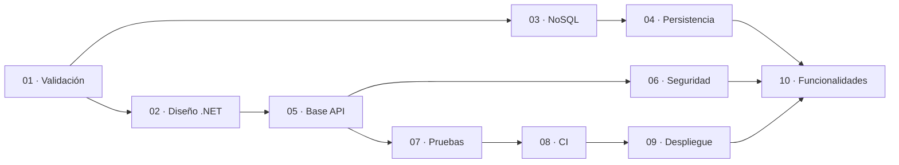
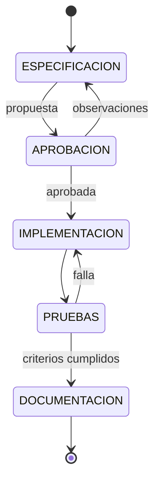

# charts.md — Etapa 10: Incorporación de especificaciones funcionales

**Versión:** 1.0.0  
**Estado:** Activo  
**Última actualización:** 2026-10-29  
**Etapa:** 10  
**Referencia:** [`plan.md`](./plan.md) | [`task.md`](./task.md)

> Diagramas del ciclo SDD por funcionalidad. No representan funcionalidades aprobadas.

---

## 1. Ciclo por funcionalidad

## 2. Secuencia de etapas previas

## 3. Estados del ciclo funcional

## 4. Mapa de trazabilidad

| Artefacto | Documento |
|-----------|-----------|
| Requisito | Por definir |
| Especificación | `spec-{módulo}.md` |
| Decisiones | `memoria.md` |
| Tareas | `task.md` / `stages/10-.../task.md` |
| Pruebas | Proyectos de prueba |
| Evidencia | Pipeline de CI |
