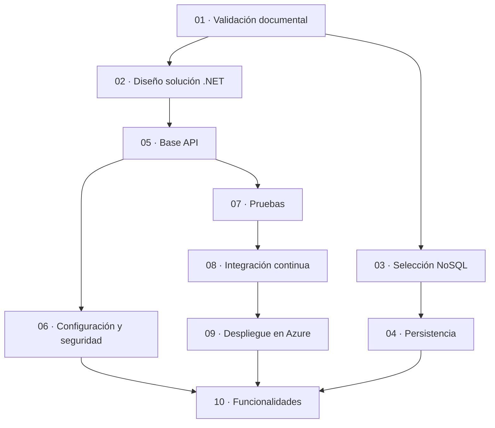

# stages/ — Documentación por etapas del Backend de BusTrack

**Versión:** 1.0.0  
**Estado:** Activo  
**Última actualización:** 2026-10-29  
**Referencia normativa:** [`constitution.md`](../constitution.md) | [`plan.md`](../plan.md) | [`task.md`](../task.md)

> Este directorio contiene la documentación detallada de cada etapa del plan de implementación. Los documentos raíz `plan.md` y `task.md` se conservan como índice general y como fuente de trazabilidad de los identificadores `TAREA-###`.

---

## 1. Convención de cada etapa

Cada carpeta de etapa contiene tres documentos:

| Documento | Propósito |
|-----------|-----------|
| `plan.md` | Objetivo, actividades, dependencias, entregables y criterios de salida de la etapa |
| `charts.md` | Diagramas Mermaid de flujo, dependencias y estados de la etapa |
| `task.md` | Tareas trazables de la etapa con estado, dependencias y criterios de aceptación |

Las etapas son **secuenciales** según lo establecido en `constitution.md` (sección 2, principio 6). Ninguna etapa puede iniciarse sin la aprobación de la anterior y sin resolver las decisiones bloqueantes indicadas.

---

## 2. Índice de etapas

| Etapa | Carpeta | Estado | Bloqueo principal |
|-------|---------|--------|-------------------|
| 01 | [`01-validacion-documentacion-sdd/`](./01-validacion-documentacion-sdd/plan.md) | 🟡 PENDIENTE | DEC-005 |
| 02 | [`02-diseno-estructura-solucion-net/`](./02-diseno-estructura-solucion-net/plan.md) | 🔴 BLOQUEADA | Fase 01 + DEC-005 |
| 03 | [`03-seleccion-proveedor-nosql/`](./03-seleccion-proveedor-nosql/plan.md) | 🔴 BLOQUEADA | Fase 01 |
| 04 | [`04-diseno-estrategia-persistencia/`](./04-diseno-estrategia-persistencia/plan.md) | 🔴 BLOQUEADA | Fases 02, 03 + DEC-001 |
| 05 | [`05-preparacion-base-api/`](./05-preparacion-base-api/plan.md) | 🔴 BLOQUEADA | Fases 02, 03 + DEC-010 |
| 06 | [`06-configuracion-y-seguridad/`](./06-configuracion-y-seguridad/plan.md) | 🔴 BLOQUEADA | Fase 05 + DEC-002, DEC-003 |
| 07 | [`07-estrategia-de-pruebas/`](./07-estrategia-de-pruebas/plan.md) | 🔴 BLOQUEADA | Fase 05 + DEC-008, DEC-009 |
| 08 | [`08-integracion-continua/`](./08-integracion-continua/plan.md) | 🔴 BLOQUEADA | Fase 07 + DEC-006 |
| 09 | [`09-despliegue-en-azure/`](./09-despliegue-en-azure/plan.md) | 🔴 BLOQUEADA | Fase 08 + DEC-007 |
| 10 | [`10-especificaciones-funcionales/`](./10-especificaciones-funcionales/plan.md) | 🔴 BLOQUEADA | Fases 01–09 |

---

## 3. Dependencias globales entre etapas

---

## 4. Trazabilidad

- Los identificadores `TAREA-###` son estables y no se reutilizan.
- Cada tarea de etapa referencia su fase en el `plan.md` raíz y la sección correspondiente de `spec.md`.
- Las decisiones `DEC-###`, riesgos `RIESGO-###` y supuestos `SUP-###` se mantienen centralizados en [`memoria.md`](../memoria.md).
- Los criterios de aceptación `AC-ARCH-##` se mantienen en [`spec.md`](../spec.md) sección 18.

---

*Los documentos de cada etapa no reemplazan a los documentos raíz: los desglosan. Ante cualquier contradicción, prevalecen `constitution.md`, `memoria.md` y `spec.md`, en ese orden.*
